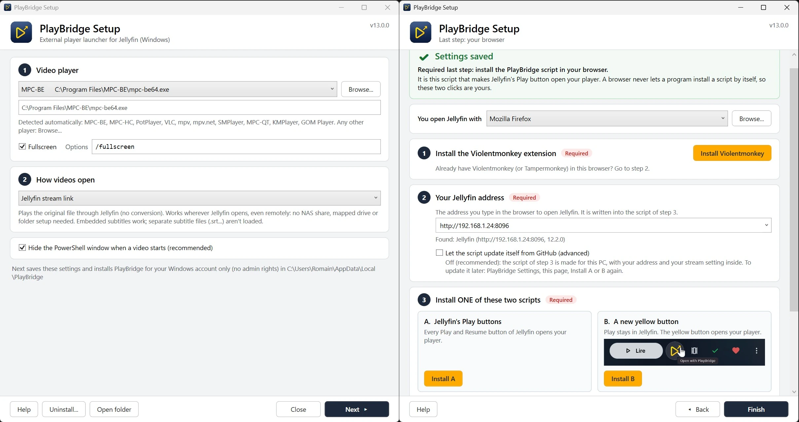

# PlayBridge ▸ External player launcher for Jellyfin
<p align="center">
  <br>
</p>

### ▸ Press Play in Jellyfin UI, watch in **your own player** on Windows: PotPlayer, MPC-BE, MPC-HC, VLC, mpv, SMPlayer... While keeping your JF mods, player settings, shaders, madVR etc.
### ▸ **This is not a client**. Think of it as a tool that gives easy access to your own media player.


<p align="center">
  <br>
</p>


> [!IMPORTANT]
> **Version 13 is a major update**: MPC-JF becomes PlayBridge.
> - **Easy install with a GUI**: double-click `Install.cmd`, pick your player, click **Next**. No admin rights, no file to edit.
> - **Works remotely too**: the new **Jellyfin stream** mode (default) plays through Jellyfin, at home or away. No NAS share or mapped drive needed.
> - **Your choice**: Jellyfin stream or download link (Jellyfin API), the **Windows file path** (local disk, NAS share), or the file path with the stream as fallback.
> - **All settings in one window**: player, fullscreen, how videos open, browser, Jellyfin address, browser script, NAS folders. Change anything later : Start menu → `PlayBridge Settings`.
>

###### PlayBridge is the new name of MPC-JF (same repository, same links). Older installations and browser scripts are upgraded automatically, see [Updating from MPC-JF](#updating-from-mpc-jf). The previous stable version is still available, see the end of this page.

### ▶︎ Features
- **Keep the original Jellyfin Web interface** (Jellyfin 12 included) with all your plugins, themes and userscripts: PlayBridge only changes what happens when you press Play.
- **Guided installer with a GUI**: double-click `Install.cmd`, pick your player. No admin rights, no file to edit, no registry file.
- **Jellyfin stream mode (default)**: your player plays the original file through Jellyfin, no conversion. Works at home and remotely, without any NAS share, mapped drive or folder setup. PlayBridge waits for sleeping NAS disks before starting the player.
- **Windows file path mode**: your player opens the file itself (local disk, NAS share, mapped drive): fastest seeking, subtitle files next to the video. PlayBridge **finds your NAS videos by itself** through your network drives and shares; if a folder can't be found, a small assistant links it in one click, once. Or both: the file path, with the stream as fallback.
- Detects your installed **players** (MPC-BE, MPC-HC, PotPlayer, VLC, mpv, mpv.net, SMPlayer, MPC-QT, KMPlayer, GOM Player; any other player with **Browse...**), your **browsers** (or pick any browser .exe) and your **Jellyfin server**, and prepares the browser script for your PC (your address and mode inside).
- Two scripts to choose from: **all Play buttons** open your player, or **a new yellow button** only. <p align="center"><br><font size="2" color="gray">Option B: the separated yellow button</font></p>
- Jellyfin Web through a browser script (Firefox, Chrome, Edge, Brave...).
- **Jellyfin Media Player / Jellyfin Desktop** (Windows app) through the JavaScript Injector plugin (experimental).
- **All settings in one window** (Start menu → PlayBridge Settings), remembered for next time. Uninstall from the same window.
- Compatible with Jellyfin 12+ (and older versions). Older MPC-JF installations and scripts are upgraded automatically.

#### Requirements & limitations
- Windows 10 or 11.
- Watched states are not synced in Jellyfin.
- **Stream or download modes** : the player must be able to open http links.
- **Windows File path mode**: compatible with all players.
- **Windows File path mode**: your videos must be reachable from Windows (local disk, NAS share, mapped drive).
- **Stream or download modes** : separate subtitle files (.srt next to the video) are not loaded; embedded work; subtitles located in the JF directory are not loaded.
- **Windows File path mode**: separate subtitle files (.srt next to the video) work; embedded work; subtitles located in the JF directory are not loaded.
- **Stream or download modes** : A stream contains your Jellyfin access token. Your player may keep it in its "recent files" list. Select the **Windows file path** option to avoid this.

> [!WARNING]
> **The only official repository is https://github.com/Damocles-fr/MPC-JF**
>
> Malicious clones sometimes rank high on Google and distribute ZIP files containing malware.
> Please report any fake repositories: "Report repository" (middle of the right sidebar) → Malware

---

## Installation

### 1. Quick installation **PlayBridge 13.0.1**
- [PlayBridge.zip](https://github.com/Damocles-fr/MPC-JF/releases/latest/download/PlayBridge.zip) (latest version, [release page](https://github.com/Damocles-fr/MPC-JF/releases/latest))
- ▸ **Right-click the downloaded .zip → Properties → check `Unblock`** → Apply.
- Extract it anywhere (your Downloads folder is fine).
- ▸ Double-click `Install.cmd`. Most users just follow the in-app instructions to set up, choose, and install the userscript.

### 2. Full setup guide. Double-click `Install.cmd` (page 1: settings)

| Setting | What to do |
|---|---|
| **1. Video player** | Your installed players are listed, the one Windows uses for videos first. Pick one, or **Browse...** to any other player .exe. Tick **Fullscreen** if you want it. |
| **2. How videos open** | **Jellyfin stream link** is selected by default: nothing else to set up, works at home and remotely. Choose **Windows file path** if your videos are on this PC or on NAS shares and you prefer the fastest seeking and subtitle files. See [How videos open](#how-videos-open). |
| **3. NAS and network folders** | Shown with the Windows file path modes only. Nothing to do in most cases: your network drives and shares are listed and used automatically. If a video doesn't open later, paste its Jellyfin path here and click **Check**. See [NAS and network drives](#nas-and-network-drives). |
| **Hide the PowerShell window** | Keep it ticked. |

**Next** saves the settings, installs PlayBridge and opens page 2.

> [!NOTE]
> - Everything is installed for your Windows account only, in `%LOCALAPPDATA%\PlayBridge`. No admin rights, no registry file, no PowerShell execution policy to change.
> - If Windows shows "Windows protected your PC": click **More info** → **Run anyway**.
> - **PotPlayer** can't be started in fullscreen directly by a command-line option: set it in PotPlayer → Preferences → General → Startup → Window Size.

### 3. Page 2: your browser (required)
A browser never lets a program install a script by itself, so these clicks are yours. At the top, choose what **you open Jellyfin with**: a web browser (your default one is preselected, **Browse...** for any other), or the Jellyfin desktop app (see step 4). The page has a button for each step and opens everything in that browser.

| Step | What to do |
|---|---|
| **1. Install Violentmonkey** | The button opens the right store for your browser ([Get Violentmonkey](https://violentmonkey.github.io/get-it/)). Tampermonkey works too. **Chrome, Edge, Brave...**: then right-click the extension icon → **Manage extension** → turn on **Allow User Scripts** (or **Developer mode** in the extensions page). |
| **2. Your Jellyfin address** | The address you type to open Jellyfin. The setup looks for Jellyfin on this PC and on your NAS. See [Auto-update](#auto-update-of-the-browser-script) for the checkbox. |
| **3. Install ONE of these two scripts** | **A**: **every Play and Resume button of Jellyfin opens your player**. **B**: Play stays in Jellyfin, a **new yellow** button opens your player. The script is prepared with your Jellyfin address and your mode; Violentmonkey opens its page: click **Install**. If you change how videos open or your Jellyfin address later, this page shows a red warning: install the script again. <p align="center"><br><font size="2" color="gray">Option B: the separated yellow button</font></p>
| **4. Restart the browser, then test** | Close **all** the windows of your browser and open it again: a browser learns the new `playbridge://` link only when it starts. **Test from the browser** opens a small page with a button that starts PlayBridge like Jellyfin would (the browser asks to open PlayBridge: tick **Always allow**). Then press Play in Jellyfin. |

Extra steps appear only when needed (auto-update with another address than `localhost`, or auto-update with a Jellyfin link mode).

#### Auto-update of the browser script
- **Off (default, recommended)**: the installed script is a copy prepared for this PC, with your Jellyfin address and your stream setting inside. It doesn't update itself: after a PlayBridge update, open **Start menu → PlayBridge Settings**, page 2, and install it again.
- **On**: the script is installed from GitHub and updates itself. Your address is not in that copy, so if Jellyfin is not at `http://localhost:8096`, add it once in Violentmonkey (the setup shows the exact line with a **Copy** button): Dashboard → PlayBridge → **`</>`** → **Settings** tab → **@match** rules → add `http://192.168.x.xx:8096/*` (keep the `*`). Tampermonkey: Settings tab → Includes/Excludes → User matches. With a stream mode, also turn on stream links (step shown by the setup).

### 4. (Experimental) Jellyfin Media Player / Jellyfin Desktop (Windows app)
Choose **Jellyfin Media Player / Jellyfin Desktop app** at the top of page 2: the steps adapt (no browser extension, the script is added on your server for this app only).
- Install the [JavaScript Injector plugin](https://github.com/n00bcodr/Jellyfin-JavaScript-Injector) on your Jellyfin server (a server restart may be required).
- Jellyfin → **Admin Dashboard → JS Injector → Add Script**. Name it PlayBridge, paste the script (**Copy the script** button; it carries your stream setting), check **Requires Authentication** and **Enabled**, **Save**.
- Open the desktop app and log in: a **PlayBridge: DeviceId of this app** box appears at the bottom. Click **Copy**.
- Back in **Dashboard → JS Injector**, replace `PUT_DEVICE_ID_HERE` with the copied DeviceId (keep the quotes), **Save**. Restart the app.

###### If the DeviceId box doesn't appear, find `deviceId` in the app log: `%LOCALAPPDATA%\JellyfinMediaPlayer\logs\JellyfinMediaPlayer.log` or `%LOCALAPPDATA%\jellyfin-desktop\Logs\jellyfin-desktop.log` (paste the path in the File Explorer address bar, open with Notepad, `Ctrl + F` → `deviceId`, copy the long string after it). The unofficial Jellium Desktop client doesn't seem to support external scripts.
###### Alternative for the yellow button in the app: Add Script, paste [PlayBridgeIcon.user.js](https://raw.githubusercontent.com/Damocles-fr/MPC-JF/refs/heads/main/PlayBridgeIcon.user.js), check **Enabled**, **Save**.

### 5. Done!
Change anything later: **Start menu → `PlayBridge Settings` (or run `Install.cmd` again)**. The setup reopens with your last choices.

---

## How videos open
Chosen on page 1, **2. How videos open**.

| Mode | How it works | Good to know |
|---|---|---|
| **Windows file path** | Your player opens the file itself (local disk, NAS share, mapped drive). | Original file, fastest seeking, subtitle files next to the video (`.srt`...) are loaded. The file must be reachable from Windows. |
| **Windows file path, or Jellyfin stream when not found** | Same, and when a video isn't found on this PC it streams from Jellyfin instead of asking. | |
| **Jellyfin stream link** (default) | Your player plays the original file through Jellyfin (`/Videos/{id}/stream?static=true`), no conversion. | **Works at home and remotely, wherever Jellyfin opens. No NAS share, mapped drive or folder link needed.** Embedded subtitles work; separate subtitle files aren't loaded. |
| **Jellyfin download link** | Same, through Jellyfin's Download link (`/Items/{id}/Download`). | Same: no NAS setup. Your Jellyfin user needs the **download** permission. |

- **Jellyfin link modes**: PlayBridge first asks Jellyfin for the video and starts your player as soon as Jellyfin answers, usually within milliseconds. Sleeping NAS disks can take up to a minute: a small **Waiting for Jellyfin** window then appears (with **Cancel**), and the player starts when the video is ready instead of giving up. If Jellyfin refuses the video (expired session, no download permission, file moved), PlayBridge says why.
- The links use the `ApiKey` parameter (Jellyfin 10.8 and newer; Jellyfin 12 turned off the old `api_key` by default) and keep `api_key` for older servers.
- With a Jellyfin link mode, the browser script sends the Jellyfin link along with the path. The copy prepared by the setup has it turned on: after switching from the file path mode, install the script again (page 2 reminds you). With auto-update, turn it on in the browser: the setup's **Turn on** button, or in Jellyfin press F12 → Console → `localStorage.setItem('playbridge-stream', 'on')` (`'off'` to stop).

> [!NOTE]
> A stream or download link contains your Jellyfin access token. Your player may keep it in its "recent files" list. PlayBridge never writes it in its own log.

### Supported players
All these players are detected by the setup (usual folders, installers, Scoop, PATH). Any other player works with **Browse...**.

| Player | Fullscreen | Stream and download modes (http links) |
|---|---|---|
| **MPC-BE**, **MPC-HC** | `/fullscreen` | Yes |
| **PotPlayer** | In PotPlayer: Preferences → General → Startup → Window Size | Yes |
| **VLC** | `--fullscreen` | Yes |
| **mpv**, **mpv.net** | `--fs` | Yes |
| **SMPlayer** | `-fullscreen` | Yes |
| **MPC-QT**, **KMPlayer**, **GOM Player** | In the player's own settings | Should work, not tested |

**Options** box: extra command-line options of your player. Put `%1` where the video must go if your player needs it (the video goes first otherwise).

---

## NAS and network drives
Jellyfin gives the path **seen by your server** (`/share/CACHEDEV1_DATA/Movies/Film.mkv` on a NAS, `/data/movies/Film.mkv` in Docker), not the path seen by Windows (`M:\Film.mkv`). PlayBridge translates it, in this order:

1. **Folder links** you saved (see below).
2. **The same path**, when Jellyfin already gives a Windows path (`D:\Films\...`, `\\NAS\share\...`).
3. **Automatic, by share name**: with `M:` mapped to `\\NAS\Movies`, `/share/CACHEDEV1_DATA/Movies/Film.mkv` opens `M:\Film.mkv`. Works for QNAP, Synology, Unraid, TrueNAS, OpenMediaVault... as long as the share name appears in the path. Shares **without a drive letter** work too (the setup finds the shares of your NAS and saves them), and so do mapped drives that Windows hasn't reconnected yet.

**PlayBridge never searches when a video starts.** It checks these few paths and starts the player within a few seconds at most, even when the NAS disks are sleeping (the player then waits for them).

#### When a video can't be found: the folder assistant
Typical cases: Docker paths, some USB disks plugged into the NAS (`/share/external/DEV3502_1/...`), renamed shares.
- PlayBridge shows a message and opens the assistant. **Search automatically** looks for the same file on all your drives and shares, two folder levels deep. Or **Pick the file myself...** in Windows.
- The folder link is saved: every video of that folder then opens directly.
- You can do the same in advance on page 1 of the setup: paste a Jellyfin path (movie page → ⋯ → **Media info** → Path) and click **Check**.

#### Folder links in PlayBridge.ini (optional)
Plain lines in `%LOCALAPPDATA%\PlayBridge\PlayBridge.ini`, section `[Paths]`: `Jellyfin folder = Windows folder`. No double backslashes, no regex. The most specific line wins.
```ini
[Paths]
/share/external/DEV3502_1 = U:\
/share/CACHEDEV3_DATA/SSD2TB = M:\
/data/movies = \\NAS\video\movies
```

#### Advanced: your own PowerShell lines
`%LOCALAPPDATA%\PlayBridge\PlayBridge-custom.ps1` (create it if needed) runs on `$path` before PlayBridge looks for the video, like the old `# YOUR NAS CONFIG` section of MPC-JF. It is kept when PlayBridge is updated.

---

## Updating from MPC-JF
- Extract the new zip anywhere (not over an old `C:\ProgramData\MPC-JF` folder) and run `Install.cmd`.
- Your player, fullscreen setting and `# YOUR NAS CONFIG` lines are **imported automatically**: simple `$path = $path -replace "\\share\\...\\", "D:"` lines become folder links, other lines are kept in `PlayBridge-custom.ps1`. Settings of the MPC-JF 12.2 test builds (`MPCJF.ini`) are imported too.
- Imported settings keep the **Windows file path** mode, so your NAS setup keeps working. The Jellyfin stream mode is the default for new installations only: choose it on page 1 if you want it.
- Old `MPCJF://` links keep working: PlayBridge registers both `playbridge://` and `mpcjf://`. The old browser scripts `MPCJF.user.js` and `MPCJFicon.user.js` update themselves to PlayBridge and keep sending the links your PC understands; still, uninstall them and install the new script from the setup when you can, once everything works.
- Your old `C:\ProgramData\MPC-JF` folder is not modified: delete it once everything works. `MPCJF.reg` and `Install-MPCJF-HiddenProtocol.ps1` are not needed anymore.
- To uninstall the old `Install-MPCJF-HiddenProtocol.ps1` : run in Powershell :
     ```
     Remove-Item -Recurse -Force "HKCU:\Software\Classes\MPCJF" -ErrorAction SilentlyContinue
     Remove-Item -Recurse -Force (Join-Path $env:LOCALAPPDATA "MPCJF") -ErrorAction SilentlyContinue
     ```

## Uninstall
Start menu → `PlayBridge Settings` (or run `Install.cmd` again) → Uninstall.... It also offers to remove an old `MPCJF.reg` registration. Then remove the script from Violentmonkey.

---

## Troubleshooting & tips
- To Resume watching the last media, set your Player settings to resume the last file automatically at opening → Potplayer's preferences → General → Startup → **Check** `Play the last played item`, and **Select** `Last used position` (and open the player instead of jellyfin to resume). (tested working in Windows File path mode)
- **Nothing happens when I press Play**: first restart the browser (all windows), then use **Test from the browser** (PlayBridge Settings, page 2): if that test works, the browser side is fine and the script is the thing to check. Also press F12 in Jellyfin: the script prints `[PlayBridge] opening ...` in the console when it sends the link. Then look at `%LOCALAPPDATA%\PlayBridge\PlayBridge.log`:
  - no new entry at all: the browser didn't start PlayBridge. Check that the script runs (Violentmonkey icon, **Allow User Scripts** on Chrome/Edge, your Jellyfin address in the script), then refresh Jellyfin (F5).
  - an entry with `play:` and `player:`: PlayBridge started your player; the problem is on the player's side (path, options).
  - an entry with `ERROR`: open an issue with the log.
- **Stream mode: the player shows an error, or PlayBridge says Jellyfin refused the video**: look at the `server   :` line in `PlayBridge.log`. `HTTP 401`: sign in to Jellyfin again in the browser. `HTTP 403`: your Jellyfin user isn't allowed (download mode: allow downloads for this user, or use the stream mode). `HTTP 404`: Jellyfin can't find the file (refresh the library). `no answer`: this PC can't reach the Jellyfin address used in the browser.
- **PlayBridge says the browser script doesn't send Jellyfin links**: the script was installed for the Windows file path mode. PlayBridge Settings → **Next** → install script A or B again.
- **Only ONE script at a time**: having both A and B, or an old MPC-JF script next to a PlayBridge one, in Violentmonkey gives double launches or strange behaviour. Remove the others.
- **Videos stop opening after a big Windows or player update**: Start menu → `PlayBridge Settings` (or run `Install.cmd` again) → PlayBridge Settings → **Next**.
- **"Scripts are disabled on this system"** when running `Install.cmd`: your PowerShell execution policy is locked by a group policy (company PC). Ask your administrator.
- **A PowerShell window flashes** at each video: VBScript is missing on your Windows (Settings → System → Optional features → VBSCRIPT). Install it, then PlayBridge Settings → Next.
- You will have to checkmark the media as watched in Jellyfin yourself...
- MPC-HC is not the best anymore to use with madVR, try PotPlayer: highly customizable, supports nearly all renderers including madVR and D3D11 with RTX video.
- If Jellyfin removed or changed your JMP deviceId: redo the `deviceId` part of the desktop app steps.
- If the player takes time to start the media, the NAS HDDs are in standby. My tiny watcher wakes them up on the Jellyfin home screen: [jellyfin-nas-hdd-spinup](https://github.com/Damocles-fr/jellyfin-nas-hdd-spinup)
- The Firefox extension **Dark Reader** breaks Jellyfin pictures: deactivate it for the Jellyfin address only.
- My guide with many **quality-of-life improvements** for Jellyfin (auto-start-stop server, fullscreen web UI, shortcut links to media folders...): [PPJF](https://github.com/Damocles-fr/PPJF/)

---

## PlayBridge.ini reference
Written by the setup, editable with Notepad.
```ini
[Player]
Path=C:\Program Files\MPC-BE\mpc-be64.exe
Arguments=/fullscreen

[Options]
; Mode: path, path+stream, stream or download
Mode=stream
HideWindow=1
Jellyfin=http://192.168.1.24:8096

[Setup]
; Last choices of the setup window
Browser=C:\Program Files\Mozilla Firefox\firefox.exe
AutoUpdate=0
Script=A
; Made for: stream links and address of the script last installed from this PC (A or B)
ScriptStream=1
ScriptMatch=http://192.168.1.24:8096/*

[Paths]
; Folder links: Jellyfin folder = Windows folder
/share/external/DEV3502_1 = U:\

[Shares]
; Network shares without a drive letter, found by the setup
\\192.168.1.24\Multimedia
```

## Files
In the zip and in `%LOCALAPPDATA%\PlayBridge`:
- ``` Install.cmd ``` : Opens the setup. The only file to double-click.
- ``` PlayBridge.ps1 ``` : Main script, started by your browser through `playbridge://` links. No need to edit it.
- ``` PlayBridge-Core.ps1 ``` : Setup window, folder assistant, update and uninstall (Start menu → `PlayBridge Settings` or run `Install.cmd` again).
- ``` PlayBridge.user.js ``` / ``` PlayBridgeIcon.user.js ``` : Browser scripts (A / B). The setup installs them in Violentmonkey.
- ``` PlayBridge-JSinjector-deviceID.js ``` : Jellyfin Media Player / Jellyfin Desktop script for the JS Injector plugin.
- ``` PlayBridge.ico ```, ``` PlayBridge-logo.png ```, ``` PlayBridgeIcon.png ``` : Images of the setup.
- ``` Readme.txt ``` : Link to this page.

Created by the setup: ``` PlayBridge.ini ``` (your settings), ``` PlayBridge.log ``` (what happened at each video launch), ``` PlayBridge-launch.vbs ``` (starts PlayBridge.ps1 without a PowerShell window), ``` PlayBridge-custom.ps1 ``` (optional, your own lines).

In the repository only: ``` MPCJF.user.js ```, ``` MPCJFicon.user.js ``` : auto-update targets of the old MPC-JF scripts, same code as the PlayBridge scripts (do not use them for a new installation).

---

### Need Help?
- Don't hesitate to open an [issue](https://github.com/Damocles-fr/MPC-JF/issues) (attach your `PlayBridge.log`, it never contains your Jellyfin token)
- **DM me**: https://forum.jellyfin.org/u-damocles
- GitHub with my other Jellyfin projects: https://github.com/Damocles-fr/

###### Since version 13, the development of PlayBridge is heavily LLM-assisted (Claude Opus and Fable), reviewed and tested by the author.
###### Prefer a version that isn't vibe-coded? The previous stable version, [MPC-JF 12.1](https://github.com/Damocles-fr/MPC-JF/releases/tag/12.1.0), is still available (manual installation, NAS videos only through mapped Windows drives, see [OLD-README.md](./OLD-README.md)). Its code is also kept in the [backup/beforeLLM](https://github.com/Damocles-fr/MPC-JF/tree/backup/beforeLLM) branch.
